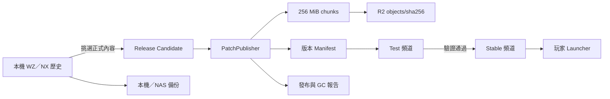

# Game Patch Depot：檔案儲存、版本管控與發布 SOP

> 文件版本：1.0  
> 狀態：建議採用的第一版基準  
> 適用產品：GMS v176 NX 資源  
> 適用範圍：檔案儲存、R2 發布、版本切換、回滾與清理  
> 不包含：遊戲 Launcher UI、帳號系統、遊戲伺服器部署

## 1. 結論

採用一個簡單且可長期維護的架構：

- 一個命令列發布工具 `PatchPublisher`。
- 一個 Cloudflare R2 Bucket。
- `test` 與 `stable` 兩個發布頻道。
- 所有發布內容切成 256 MiB chunks，以 SHA-256 作為物件名稱。
- 每個版本由一份不可變 Manifest 完整描述。
- R2 只保留目前正式版、前兩個回滾版本及目前測試版實際引用的物件。
- 本機歷史 NX、原始 WZ 與轉換快取不直接同步到 R2。
- 不使用資料庫、Web 後臺、微服務或長串 Patch 鏈。

這個版本的重點是「可靠、能回滾、不誤刪、能限制空間」，不是追求最多功能。

## 2. 已確認的現況

目前資料來源：

```text
F:\MSPrivate\NoLifeWzToNx\wz
```

實際盤點：

| 範圍 | 數量 | 大小 |
| --- | ---: | ---: |
| 上層歷史 NX | 78 | 54.72 GiB |
| 上層歷史 WZ | 78 | 28.41 GiB |
| 上層歷史合計 | 157 | 83.13 GiB |
| `wz\n\*.nx` 現行集合 | 16 | 8.57 GiB |

已確認：

- `wz\n\UI.nx` 與 `UI39.nx` SHA-256 相同。
- `UI40.nx` 是不同內容，大小為 607,577,868 bytes。
- `UI40.nx` 超過 Cloudflare Free／Pro／Business 的 512 MB 單一快取物件上限。
- 現有命名同時包含 `UI40`、`Map_v2`、`Map5`、`Etc5`、`Character189_7`，不能靠檔名自動猜測最新版。

因此，編號檔只作為本機歷史來源；正式版本一律由 Candidate 與 Manifest 決定。

## 3. 系統邊界與唯一真相來源

不同資料有不同的唯一真相來源，不可混用：

| 資料 | 唯一真相來源 |
| --- | --- |
| 原始 WZ、歷史 NX | 本機／NAS 備份 |
| 某次發布應安裝哪些檔案 | Release Manifest |
| 玩家目前應使用哪個版本 | `channels/stable.json` |
| 真正提供下載的二進位內容 | R2 `objects/sha256/` |
| 發布紀錄與審核結果 | Git 中的 catalog、reports |

R2 是發布站，不是原始資料的唯一備份，也不是整個 `wz` 資料夾的鏡像。

## 4. 整體架構



## 5. 專案結構

建立獨立專案：

```text
F:\MSPrivate\GamePatchDepot\
├─ README.md
├─ docs\
│  ├─ ARCHITECTURE.md
│  ├─ RELEASE-SOP.md
│  ├─ ROLLBACK-SOP.md
│  └─ STORAGE-GC-SOP.md
├─ config\
│  ├─ product.json
│  └─ allowed-files.json
├─ catalog\
│  ├─ releases\
│  └─ channels\
├─ reports\
│  ├─ builds\
│  ├─ publishes\
│  └─ garbage-collection\
├─ src\
│  └─ PatchPublisher\
└─ work\
   ├─ candidates\
   ├─ chunks\
   ├─ downloads\
   └─ staging\
```

Git 規則：

- `docs`、`config`、`catalog`、`reports`、`src` 納入 Git。
- `work`、NX、WZ、cache、密鑰不得納入 Git。
- R2 Token 不得寫在設定檔或原始碼。

## 6. 第一版刻意不做的功能

為控制複雜度，第一版不做：

- Web 管理後臺。
- SQL／NoSQL 資料庫。
- 微服務。
- 自動解析 `UI40`、`Map5` 等檔名來猜最新版。
- 自動直接發布 stable。
- UI1 → UI2 → UI3 這類長串 Patch 鏈。
- xdelta／bsdiff。
- 自動刪除所有超過固定天數的正式 objects。

若實際下載量證明固定分塊仍不足，再把 xdelta 列為第二階段。

## 7. 設定檔

`config/product.json`：

```json
{
  "schemaVersion": 1,
  "product": "gms-v176",
  "sourceRoot": "F:\\MSPrivate\\NoLifeWzToNx\\wz",
  "candidateRoot": "F:\\MSPrivate\\GamePatchDepot\\work\\candidates",
  "bucket": "gms-v176-patch",
  "publicBaseUrl": "https://patch.example.com",
  "chunkSizeMiB": 256,
  "keepStableReleases": 3,
  "orphanGraceDays": 14,
  "temporaryRetentionDays": 7
}
```

`config/allowed-files.json`：

```json
{
  "files": [
    "Base.nx",
    "Character.nx",
    "Effect.nx",
    "Etc.nx",
    "Item.nx",
    "Map.nx",
    "Mob.nx",
    "Morph.nx",
    "Npc.nx",
    "Quest.nx",
    "Reactor.nx",
    "Skill.nx",
    "Sound.nx",
    "String.nx",
    "TamingMob.nx",
    "UI.nx"
  ]
}
```

發布工具遇到下列情況必須停止：

- 缺少允許清單中的檔案。
- 出現未知 NX、WZ、OBJ、cache 或暫存檔。
- 檔名重複。
- 路徑含有絕對路徑、`..`、junction 或 symlink 逃逸。
- 檔案在雜湊期間被修改。
- Release ID 或 contentVersion 已使用。

## 8. Release Candidate

每次發布建立一個凍結的候選目錄：

```text
work\candidates\2026.09.23.1\
├─ Base.nx
├─ Character.nx
├─ Effect.nx
├─ Etc.nx
├─ Item.nx
├─ Map.nx
├─ Mob.nx
├─ Morph.nx
├─ Npc.nx
├─ Quest.nx
├─ Reactor.nx
├─ Skill.nx
├─ Sound.nx
├─ String.nx
├─ TamingMob.nx
├─ UI.nx
└─ release-info.json
```

例如發布 UI40：

```text
來源：wz\UI40.nx
安裝名稱：UI.nx
```

Candidate 完成後不得再修改。若需要修改，建立新的 Release ID，不覆寫已 Build 的版本。

Candidate 是暫存工作區；stable 滿 14 天且原始資料已有備份後，可以刪除 Candidate。

## 9. 版本規範

Release ID：

```text
YYYY.MM.DD.流水號
```

例如：

```text
2026.09.23.1
2026.09.23.2
2026.09.30.1
```

另外保存只增不減的整數：

```text
contentVersion: 1008
```

規則：

- Release ID 一經 Build 不重複使用。
- contentVersion 永遠增加，回滾也增加。
- 已發布 Manifest 不覆蓋。
- 檔案修改時間不作為版本或完整性依據。
- 編號來源檔只記在 `sourceRevision`，玩家不依賴此編號。

## 10. R2 物件結構

```text
gms-v176-patch/
├─ channels/
│  ├─ test.json
│  └─ stable.json
├─ channel-history/
│  ├─ test/
│  └─ stable/
├─ manifests/
│  ├─ 2026.09.23.1.json
│  ├─ 2026.09.23.1.sig
│  ├─ 2026.09.30.1.json
│  └─ 2026.09.30.1.sig
├─ objects/
│  └─ sha256/
│     ├─ 00/
│     ├─ 01/
│     └─ ...
├─ locks/
│  └─ production-operation.json
└─ tmp/
```

禁止使用每版完整複製的配置：

```text
releases/1/all-files
releases/2/all-files
releases/3/all-files
```

所有實際內容一律依 SHA-256 命名：

```text
objects/sha256/fb/FB20F1F4EAD43640...
```

相同 chunk 在所有版本與檔案之間只儲存一份。

## 11. Chunk 規格

固定 chunk 大小：

```text
256 MiB = 268,435,456 bytes
```

最後一個 chunk 可以較小。

`UI40.nx` 的切分結果：

```text
總大小：607,577,868 bytes
Chunk 0：268,435,456 bytes
Chunk 1：268,435,456 bytes
Chunk 2： 70,706,956 bytes
```

重要限制：

- 固定分塊主要解決 CDN 快取、續傳及物件去重。
- NX 是大型容器；若前段資料插入導致後方位移，許多 chunk 仍可能改變。
- 不承諾小幅資源修改一定只需下載一個 chunk。
- Launcher 最後仍須驗證完整 NX 的 SHA-256。

## 12. Manifest

Manifest 必須完整列出該版本的 16 個檔案，不只列出本次變更。

```json
{
  "schemaVersion": 1,
  "releaseId": "2026.09.23.1",
  "contentVersion": 1008,
  "gameVersion": "GMS176",
  "minimumLauncherVersion": "1.0.0",
  "createdAt": "2026-09-23T12:00:00Z",
  "files": [
    {
      "path": "UI.nx",
      "sourceRevision": "UI40",
      "size": 607577868,
      "sha256": "FB20F1F4EAD436401DC78A2254399573629A74D150CB64BC3C0076568EB000D4",
      "chunks": [
        {
          "offset": 0,
          "size": 268435456,
          "sha256": "<chunk-sha256>",
          "key": "objects/sha256/xx/<chunk-sha256>"
        }
      ]
    }
  ],
  "delete": []
}
```

每個檔案最少具有：

- 安裝相對路徑。
- 完整大小。
- 完整 SHA-256。
- 每個 chunk 的 offset、size、SHA-256 與 R2 key。

ETag 不作為檔案 SHA-256 使用。

## 13. 簽章與頻道切換修正

### 13.1 Manifest

Manifest 是不可變物件，可以使用：

```text
manifests/<releaseId>.json
manifests/<releaseId>.sig
```

簽章針對 Manifest 檔案的原始 UTF-8 bytes，不重新序列化後再驗證。

### 13.2 Channel

`stable.json` 與簽章不可分成兩次獨立切換，否則玩家可能短暫取得新 JSON 與舊簽章。

Channel 必須是一個單一 signed envelope。為了避免 JSON canonicalization 實作差異，payload 先序列化為固定 UTF-8 bytes，再以 Base64 放進 envelope；簽章直接針對這份原始 bytes：

```json
{
  "schemaVersion": 1,
  "algorithm": "ECDSA-P256-SHA256",
  "payloadBase64": "<ChannelPayload 的 UTF-8 bytes>",
  "signatureBase64": "<payload bytes 的簽章>"
}
```

解碼後的 ChannelPayload 包含 channel、generation、releaseId、contentVersion、manifestKey、manifestSha256 與 publishedAt。這個格式只有一個可見切換物件，也不依賴一般 JSON serializer 的欄位順序。

Launcher 必須拒絕：

- 簽章錯誤。
- Manifest SHA-256 不符。
- `contentVersion` 低於或等於已安裝版本，但 Release ID 卻不同。
- `generation` 低於已接受的 generation。

回滾版本仍使用更高的 contentVersion，因此不需要允許版本倒退。

## 14. Cloudflare Cache Rules

因為 `objects/sha256/...` 沒有一般副檔名，不能只依賴 Cloudflare 預設快取類型。

規則順序必須是：

1. `/channels/*`：Bypass Cache。
2. `/channel-history/*`：Eligible for Cache，長 TTL。
3. `/manifests/*`：Eligible for Cache，長 TTL。
4. `/objects/*`：Cache Everything／Eligible for Cache，長 TTL。

HTTP metadata：

```text
/channels/*
Cache-Control: no-store, no-cache, max-age=0

/manifests/*
Cache-Control: public, max-age=31536000, immutable

/objects/*
Cache-Control: public, max-age=31536000, immutable
```

正式環境使用自訂網域，例如：

```text
https://patch.example.com
```

不得使用 `r2.dev` 作為正式玩家下載入口。

## 15. 發布工具命令

第一版只建立一個 CLI：

```text
PatchPublisher.exe
```

命令：

```powershell
PatchPublisher build --release 2026.09.23.1
PatchPublisher diff --release 2026.09.23.1 --against stable
PatchPublisher upload --release 2026.09.23.1
PatchPublisher verify --release 2026.09.23.1
PatchPublisher promote --release 2026.09.23.1 --channel test
PatchPublisher promote --release 2026.09.23.1 --channel stable
PatchPublisher rollback --to 2026.09.07.1
PatchPublisher gc --dry-run
PatchPublisher gc --apply --report <report-id>
```

工具模組：

1. Candidate Validator。
2. SHA-256 Hasher。
3. Fixed Chunker。
4. Manifest Builder。
5. R2 Object Uploader。
6. Release Verifier。
7. Channel Promoter。
8. Garbage Collector。
9. Report Writer。

## 16. 並行控制

發布與 GC 不得同時執行。

PatchPublisher 在開始可變更操作前，必須取得唯一操作鎖：

```text
locks/production-operation.json
```

鎖至少包含：

```json
{
  "operation": "publish",
  "owner": "publisher-machine",
  "startedAt": "2026-09-23T12:00:00Z",
  "expiresAt": "2026-09-23T14:00:00Z"
}
```

要求：

- 使用條件式建立，已存在時不得覆寫。
- 鎖必須有到期時間，避免程序崩潰後永久鎖死。
- 長時間操作必須定期續租，續租時核對 operation ID。
- 若續租失敗，程序不得 Promote 或繼續刪除物件。
- Promote 與每一批 GC 刪除前，都要再次確認鎖仍屬於目前 operation ID 且尚未過期。
- `publish`、`promote`、`rollback`、`gc apply` 共用同一把鎖。
- `build`、`diff`、`gc dry-run` 可以只讀執行。
- 強制解鎖必須產生稽核報告。

## 17. 標準發布 SOP

### 17.1 Prepare

1. 建立新的 Release ID 與 contentVersion。
2. 從上一版建立 Candidate。
3. 以本次來源替換安裝檔，例如 `UI40.nx` → `UI.nx`。
4. 填寫 `release-info.json`。
5. 凍結 Candidate。

### 17.2 Build

```powershell
PatchPublisher build --release 2026.09.23.1
```

Build 必須：

- 驗證允許清單。
- 記錄開始與結束時的 size、mtime，偵測中途修改。
- 計算完整檔案 SHA-256。
- 切分並計算 chunk SHA-256。
- 產生 Manifest 與簽章。
- 產生與 stable 的差異報告。

### 17.3 Review

操作者必須確認：

- Changed、Added、Deleted 符合預期。
- 沒有 WZ、cache 或未知 NX。
- 預估新增儲存量與玩家下載量合理。
- Release ID、contentVersion 正確。

### 17.4 Upload

```powershell
PatchPublisher upload --release 2026.09.23.1
```

規則：

- 先取得 production operation lock。
- 對每個 hash key 檢查是否已存在。
- 已存在且大小一致則跳過。
- 已存在但大小不一致則立即中止並告警。
- 只上傳缺少的 chunks。
- 上傳可安全重跑，不製造重複物件。
- 新上傳物件至少保留 14 天，避免 GC 刪除尚未被 Manifest 引用的內容。

### 17.5 Verify

```powershell
PatchPublisher verify --release 2026.09.23.1
```

必須檢查：

- Manifest 簽章正確。
- 所有引用物件存在且大小一致。
- 所有新上傳 chunk 可以讀取。
- 所有本次變更檔案可以從 R2 chunks 重組。
- 重組檔案 SHA-256 與 Manifest 相同。

任何一項失敗，不得 Promote。

### 17.6 Test

```powershell
PatchPublisher promote --release 2026.09.23.1 --channel test
```

測試：

- 上一版更新到 Test。
- 中斷後續傳。
- 更新後全部檔案雜湊正確。
- 全新安裝可完整重建。
- 遊戲啟動、登入、選角、進入地圖。
- 刪除清單沒有超出遊戲安裝根目錄。

### 17.7 Stable

```powershell
PatchPublisher promote --release 2026.09.23.1 --channel stable
```

Stable 是最後一個動作。Promote 前必須再次確認：

- Test 指向相同 Manifest SHA-256。
- Verify 結果仍有效。
- stable generation 尚未被其他操作更新。
- 所有 referenced objects 仍存在。

Promote 使用條件式寫入；若 generation 已改變，停止而不是覆蓋。

完成後：

- 保存發布報告。
- 記錄操作者與時間。
- 監看 30 至 60 分鐘。
- 上一版不得立即刪除。

## 18. 回滾 SOP

假設：

```text
1007：正常
1008：有問題
```

不得直接把 stable 的 contentVersion 改回 1007。

建立：

```text
releaseId: 2026.09.23.2
contentVersion: 1009
description: rollback 1008 to 1007 content
```

1009 Manifest 重新引用 1007 的 objects，不重新上傳相同內容。

流程：

1. `rollback --to 2026.09.07.1` 產生新 Manifest。
2. Verify。
3. Promote 到 test。
4. 確認已更新玩家可回到正常檔案。
5. Promote 到 stable。
6. 保存事故與回滾報告。

目標：不重新上傳大型 NX，10 分鐘內完成可驗證的版本切換。

## 19. 保留政策

| 類型 | 保留規則 |
| --- | --- |
| Current stable | 保留 |
| Previous stable 1 | 保留 |
| Previous stable 2 | 保留 |
| Current test | 保留 |
| 新上傳但未引用物件 | 至少 14 天 |
| R2 暫存／失敗 multipart | 7 天 |
| Candidate | Stable 後 14 天 |
| Git 中 Manifest 與報告 | 永久保存 |

R2 上的舊 Manifest 若對應 objects 已清除，就只具有稽核用途，不再承諾可下載。Git Catalog 必須標記該版本為 `retired` 或 `purged`。

## 20. Garbage Collection SOP

### 20.1 Roots

GC 保留集合必須從下列 roots 計算：

- Current stable。
- Previous stable 1。
- Previous stable 2。
- Current test。
- 尚未超過 14 天寬限期的新 objects。

### 20.2 Dry Run

```powershell
PatchPublisher gc --dry-run
```

報告必須記錄：

- 執行時的 stable generation。
- 執行時的 test generation。
- 保留 release IDs。
- 保留 objects。
- 可刪除 objects。
- 預計釋放容量。
- 每個候選物件最後被哪一版引用。

### 20.3 Apply 前重新驗證

原設計中「完全依舊報告直接刪除」是不安全的。Dry Run 與 Apply 之間可能發布新版本，讓原本的孤兒物件重新被引用。

因此 `gc --apply` 必須：

1. 取得 production operation lock。
2. 重新讀取 stable 與 test generation。
3. generation 和報告不同時，整次 GC 中止並重新 Dry Run。
4. 重新計算目前所有 roots 的 reachability。
5. 從刪除清單移除任何目前已被引用的物件。
6. 再次檢查 14 天寬限期。
7. 才執行刪除。

### 20.4 Lifecycle 使用範圍

R2 Lifecycle 只用於：

```text
tmp/
未完成 multipart uploads
```

不得對 `objects/sha256/` 設定「超過 N 天自動刪除」。物件年齡和是否仍被目前版本使用沒有直接關係。

## 21. 空間上限

目前正式集合約 8.57 GiB。

| 狀態 | 使用量 |
| --- | ---: |
| 正常 | 10 至 15 GiB |
| 注意 | 超過現行集合 2 倍，約 17 GiB |
| 必須執行 GC | 超過 3 倍，約 25.7 GiB |
| 阻止非必要發布 | 超過 4 倍，約 34.3 GiB |

這是內部管理門檻，不是 R2 技術限制。

## 22. 權限與密鑰

- R2 Bucket 對玩家只提供公開 GET。
- Launcher 不持有 R2 API Token。
- Publisher 使用只限該 Bucket 的 Write Token。
- 本機 Token 由 Windows DPAPI 加密，存放於使用者的 `%LOCALAPPDATA%\GamePatchDepot\credentials.json`；CI 則使用 CI Secret。
- Token 不進 Git、不進 JSON、不寫入發布報告。
- Manifest 簽章私鑰和 R2 Token 分開保存。
- 簽章私鑰至少有一份離線備份。
- Launcher 只內建簽章公鑰。
- 正式 Bucket 的人工 Dashboard 刪除只限事故處理。

## 23. 備份

至少保存：

- 原始 WZ。
- NoLifeWzToNx 原始碼及建置版本。
- 轉換參數與設定。
- 現行及前兩版正式 NX。
- 所有 Manifest、簽章與發布報告。
- 簽章私鑰離線備份。

建議：

| 位置 | 用途 |
| --- | --- |
| 工作電腦 | 日常作業 |
| NAS | 每日或每週備份 |
| 離線磁碟 | 每月備份 |
| R2 | 玩家發布內容 |

## 24. 監控

第一版只需要簡單監控：

- `channels/stable.json` 是否可取得且簽章有效。
- Stable Manifest 是否可取得。
- Manifest 所有 objects 是否存在。
- 每日 R2 儲存量。
- 4xx／5xx 與下載失敗率。
- 新版本發布後 30 至 60 分鐘內的 Launcher 錯誤率。

不需要第一版就建立大型監控平臺。

## 25. 每次發布核對表

```text
[ ] 建立新的 releaseId
[ ] contentVersion 已增加
[ ] Candidate 只有允許的 16 個 NX
[ ] Candidate 已凍結
[ ] Build 成功
[ ] Changed／Added／Deleted 符合預期
[ ] 新增儲存量與下載量合理
[ ] Upload 成功
[ ] Verify 通過
[ ] Test channel 更新成功
[ ] 上一版更新測試通過
[ ] 中斷續傳測試通過
[ ] 全新重建測試通過
[ ] 遊戲啟動與登入通過
[ ] Stable generation 沒有衝突
[ ] Stable 最後才切換
[ ] 發布報告已保存
[ ] 上一版沒有被立即刪除
```

## 26. GC 核對表

```text
[ ] 已完成 Dry Run
[ ] 報告包含 stable/test generation
[ ] Current stable 被保留
[ ] Previous stable 1 被保留
[ ] Previous stable 2 被保留
[ ] Current test 被保留
[ ] 14 天內新物件被保留
[ ] 已取得 production operation lock
[ ] Apply 前 generation 未改變
[ ] Apply 前已重新計算 reachability
[ ] 刪除後 Stable Verify 通過
[ ] GC 報告已保存
```

## 27. 第一版驗收標準

PatchPublisher v1 必須通過：

1. 相同 chunk 不會重複上傳。
2. 只改 UI 時不會上傳其他未變更 NX 的新內容。
3. UI40 能正確切成三個小於 512 MB 的 chunks。
4. 上傳中斷後可安全重跑。
5. Candidate 在雜湊過程中變動會被偵測並中止。
6. 缺少任何 referenced object 時無法 Promote。
7. R2 chunks 能重建出與 Manifest 相同 SHA-256 的 NX。
8. Channel 切換只有一個可見更新點，不會發生 JSON／簽章錯配。
9. 兩個 Publisher 同時操作時，只有一個能取得鎖。
10. Publish 和 GC 不能同時執行。
11. GC Apply 遇到 channel generation 改變會中止。
12. GC 不會刪除現行、測試及兩個回滾版本引用的物件。
13. 回滾不需重新上傳已存在的大型 chunks。
14. API Token 不出現在 Git、報告或 Launcher。
15. `/objects/*` 命中明確的 Cloudflare Cache Rule。

## 28. 導入順序

### Phase 1：儲存與發布核心

- 專案與設定檔。
- Candidate 驗證。
- SHA-256 與固定分塊。
- Manifest 產生。
- R2 去重上傳。
- Verify 與重建測試。
- test／stable Promote。
- 操作鎖。
- GC Dry Run／Apply。

### Phase 2：Launcher 更新

- 讀取 signed channel。
- 下載並驗證 Manifest。
- Chunk 續傳。
- 暫存重建 NX。
- 完整 SHA-256 驗證。
- 原子替換與失敗回復。

### Phase 3：依數據決定是否加入

- xdelta／bsdiff。
- 更完整的下載統計。
- CI 自動 Build。
- 多人審核流程。

沒有下載數據證明必要前，不提前實作 Phase 3。

## 29. 最終規範摘要

1. 不把整個 `wz` 同步到 R2。
2. 不靠檔名編號猜最新版。
3. Candidate 決定本次內容，Manifest 決定正式版本。
4. 實際內容使用 SHA-256 key，不覆寫。
5. 大檔固定切成 256 MiB chunks。
6. test 通過後才能 stable。
7. Channel 使用單一 signed envelope，避免簽章切換競態。
8. Publish、Rollback、GC 共用操作鎖。
9. Stable、Test 與兩個回滾版本是 GC roots。
10. GC Apply 必須重新確認 generation 與引用，不盲信舊報告。
11. R2 只保存玩家發布內容；原始檔另行備份。
12. 第一版維持一個 CLI、一個 Bucket、兩個 Channel、零資料庫。
